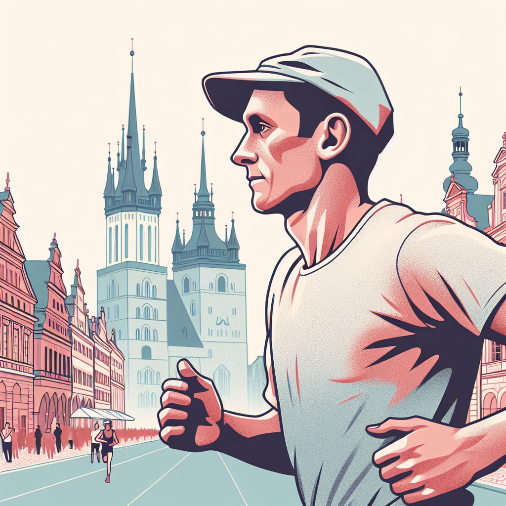
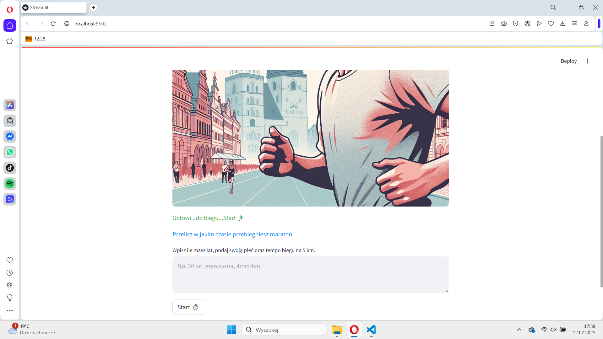
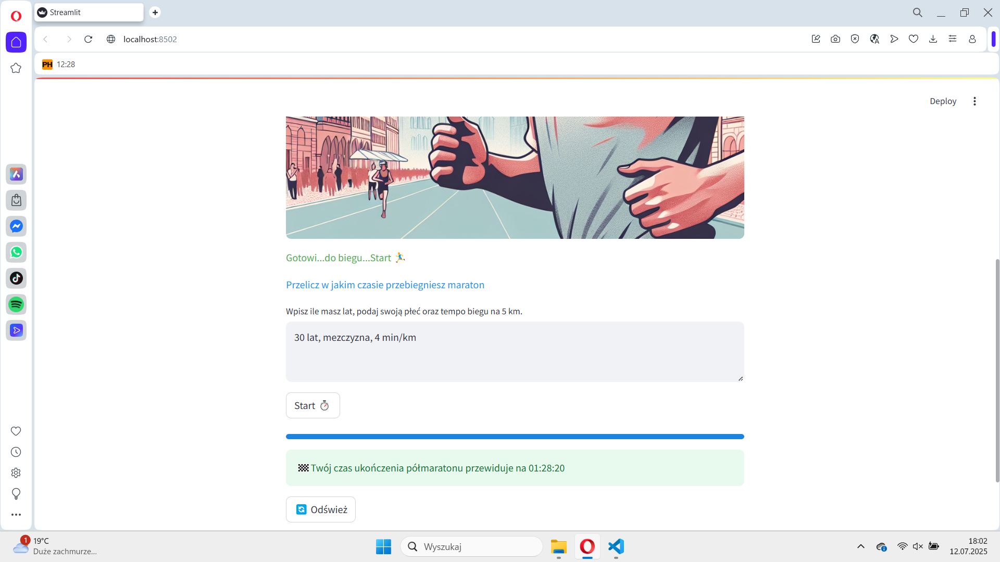

# Półmaraton

Wpisuujesz płeć, wiek i czas na 5 km. Aplikacja szacuje wynik na półmaratonie i dopisuje krótką rekomendację treningową.

Model regresji jest na wynikach wrocławskich półmaratonów z 2023–2024, po czyszczeniu danych. Rekomendację tekstową składa GPT. Aplikacja była na DigitalOcean.

To starszy projekt — zostawiam go, bo są prawdziwe dane i był deploy. Dziś więcej czasu idzie w Tarcza i HistoryChat.

## Stack

Python, Streamlit, PyCaret, Pandas, OpenAI, DigitalOcean

[Repozytorium](https://github.com/Rafal-codeBenderz/Maraton.git)

*Przykładowe ekrany:*

